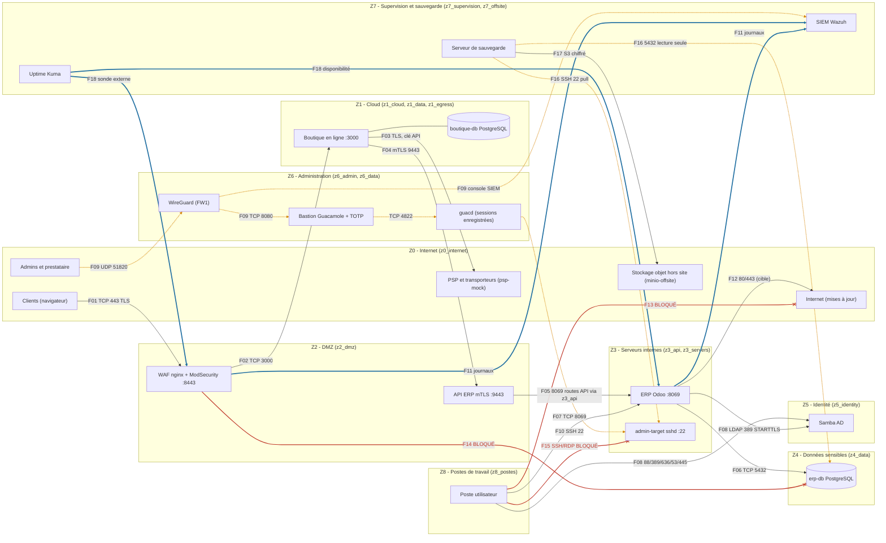
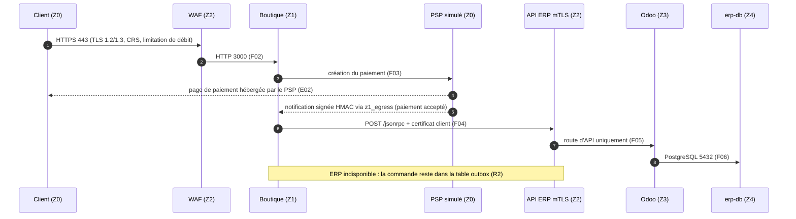

# OSTRAL — Architecture de la maquette Docker

> Projet M2 Cybersécurité EFREI 2026 — entreprise fictive OSTRAL (mobilier et décoration en ligne).
> Ce document décrit comment la maquette Docker Compose reproduit l'architecture cible du
> *dossier d'architecture sécurisée* (ateliers 1 à 3), et où elle s'en écarte.

## 1. Vue d'ensemble

L'architecture cible retenue est **hybride (H3)** : la boutique, exposée et soumise à des pics de
charge (Black Friday), est hébergée dans le cloud ; l'ERP, l'annuaire, le bastion, le SIEM et la
sauvegarde restent au siège. Le SI est découpé en **9 zones (Z0 à Z8)** séparées par deux
pare-feux d'éditeurs différents (FW1 côté cloud, FW2 côté siège), avec une DMZ entre les deux.

Les cinq principes appliqués :

| Principe | Traduction dans la maquette |
|---|---|
| Défense en profondeur | WAF ModSecurity + OWASP CRS, mTLS boutique → ERP, réseaux Docker cloisonnés, bastion + VPN + TOTP |
| Moindre privilège | un conteneur n'est attaché qu'aux réseaux de ses flux autorisés ; compte technique `api-boutique` dans Odoo ; sauvegarde en lecture seule |
| Cloisonnement | 14 réseaux Docker (dont 13 `internal: true`) pour 9 zones, dont un réseau dédié `z3_api` limité au WAF et à l'API Odoo |
| Résilience | file d'attente des commandes (R2), sauvegardes 3-2-1-1-0, supervision Uptime Kuma |
| Réduction de la surface d'attaque | deux points d'entrée : **443/tcp** (F01, plus 80/tcp qui ne fait que rediriger vers HTTPS) et **51820/udp** (F09). Le PSP simulé (Z0 logique) est publié sur `127.0.0.1:4000` pour que le navigateur affiche sa page de paiement ; le relais `bastion-demo` (`127.0.0.1:8080`) n'existe qu'avec le profil `demo` |

La maquette tourne sur un seul hôte Docker. Le projet compose s'appelle `ostral` : les réseaux réels
sont donc nommés `ostral_<réseau>` (ex. `ostral_z4_data`) et les volumes `ostral_<volume>`.

## 2. Schéma des zones et des flux

Légende : **trait plein** = flux AUTORISÉ ; **pointillés** = flux RESTREINT (MFA, enregistrement) ;
**trait épais** = flux SURVEILLÉ ; **trait rouge terminé par une croix** = flux BLOQUÉ (testé).

> Le relais `bastion-demo` (profil `demo`, `127.0.0.1:8080`) n'est pas représenté : il contourne
> volontairement F09 pour une démonstration sans client WireGuard (le TOTP et l'enregistrement
> des sessions restent appliqués).
>
> Numérotation des liens (pour `linkStyle`) : 0 = F01 … 16 = F12, 17–19 = flux bloqués F13/F14/F15,
> 20–21 = F16, 22 = F17, 23–24 = F18, 25 = lien boutique / base.

## 3. Correspondance zones → services → réseaux Docker

| Zone | Rôle (dossier) | Services compose | Réseaux Docker (IP) |
|---|---|---|---|
| **Z0** Internet | Clients, PSP, transporteurs, admins à distance | hôte (navigateur, client WireGuard), `psp-mock` (logique), `minio-offsite` et `minio-offsite-init` (logique, 2ᵉ fournisseur) | `z0_internet` 10.10.0.0/24 (seul réseau non `internal`) ; `psp-mock` sur `z0_internet` 10.10.0.40 (publié `127.0.0.1:4000`) et `z1_egress` 10.10.11.30 ; `minio-offsite` 10.10.17.50 et `minio-offsite-init` 10.10.17.51 sur `z7_offsite` |
| **Z1** Cloud | Boutique sans adresse publique | `boutique`, `boutique-db` | `z1_cloud` 10.10.1.20, `z1_data` 10.10.12.20/.30, `z1_egress` 10.10.11.20 |
| **Z2** DMZ | Reverse proxy + WAF, aucune donnée | `waf` (publie `443:8443` et `80:8080` pour la redirection) | `z0_internet` .0.10, `z2_dmz` .2.10, `z1_cloud` .1.10 (API mTLS 9443), `z3_api` .13.10 |
| **Z3** Serveurs | ERP Odoo | `odoo`, `admin-target` | `z3_api` 10.10.13.0/24 : `waf` .13.10 et `odoo` .13.20 seulement (F05) ; `z3_servers` : `odoo` .3.20, `admin-target` .3.30 (Odoo aussi sur `z4_data` .4.10, `z5_identity` .5.20, `z8_postes` .8.20) |
| **Z4** Données | PostgreSQL ERP, aucune sortie | `erp-db`, `odoo-init` (amorçage ponctuel : base `ostral`, utilisateur `api-boutique`, clé API, LDAP) | `z4_data` .4.20 / .4.12 |
| **Z5** Identité | Active Directory | `samba-ad` (contrôleur `dc1.ostral.local`, comptes de démonstration `alice.martin`, `bruno.durand`, `chloe.petit`, `adm.claire`) | `z5_identity` .5.10 |
| **Z6** Administration | VPN, bastion | `wireguard`, `guacamole` 1.6.0, `guacd`, `guac-db` ; `bastion-demo` (profil `demo`) | `z6_admin` .6.5/.6.10/.6.11, `z6_data` .16.10/.16.20 ; `guacd` a une patte dans chaque zone administrée (Z2–Z5, Z7) mais n'écoute que sur 10.10.6.11 ; `bastion-demo` sur `z0_internet` .0.21 et `z6_admin` .6.6 |
| **Z7** Supervision | SIEM, disponibilité, sauvegarde | `wazuh-manager`, `wazuh-indexer`, `wazuh-dashboard` 4.14.4 et `wazuh-ism-init` (profil `siem`), `uptime-kuma`, `backup` | `z7_supervision` .7.x (`wazuh-ism-init` .7.25) ; `uptime-kuma` aussi sur `z0_internet` (sonde externe) et `z3_servers` ; `backup` sur `z4_data`, `z3_servers`, `z7_offsite` |
| **Z8** Postes | Postes de travail | `poste` | `z8_postes` .8.30, `z5_identity` .5.30 |

Le détail des IP fixes est dans [`SPEC.md`](../SPEC.md).

## 4. Modélisation des pare-feux par appartenance réseau

Dans l'architecture cible, FW1 (cloud) et FW2 (siège) appliquent la matrice de flux avec une
**règle par défaut « tout ce qui n'est pas autorisé est refusé et journalisé »**. Dans la maquette :

1. **Un réseau Docker = un segment derrière une interface de pare-feu.** Tous les réseaux sauf
   `z0_internet` sont déclarés `internal: true` : Docker n'y installe aucune passerelle vers
   l'extérieur, ce qui interdit toute sortie Internet (F12, F13, exfiltration depuis Z4).
2. **Un conteneur n'est attaché qu'aux réseaux nécessaires à ses flux autorisés.** Exemple : la
   boutique n'a aucune interface sur `z3_api`, `z3_servers` ni `z4_data` ; un accès direct à
   l'ERP ou à sa base est donc *structurellement impossible* (E05), et pas seulement filtré. De même,
   le WAF ne partage avec l'ERP que le réseau dédié `z3_api` (deux membres) : une DMZ compromise
   n'atteint ni `admin-target`, ni `guacd`, ni les autres serveurs de `z3_servers` (F14).
3. **Docker isole les ponts entre eux** (chaînes `DOCKER-ISOLATION`) : deux réseaux distincts ne
   communiquent jamais, même si un conteneur a une patte dans chacun (il n'y a pas de routage IP
   entre ses interfaces, sauf pour WireGuard qui le fait explicitement).
4. **Les conteneurs « multi-zones » jouent le rôle de proxy applicatif, pas de routeur** :
   le WAF ne relaie que HTTP vers des routes précises (F02, F05) ; `guacd` ne relaie que des
   sessions SSH ouvertes et enregistrées par le bastion (F10) ; `backup` ne fait que tirer des
   données (F16).
5. **Le conteneur WireGuard** est l'équivalent de la fonction VPN de FW1 : il est le seul à router
   (IP forwarding) et applique des règles `iptables` qui limitent les pairs VPN au bastion
   (TCP 8080) et à la console SIEM (F09). Les règles sont **par pair nominatif** : `admin1` et
   `admin2` atteignent le bastion, Wazuh et Uptime Kuma ; le pair prestataire `agenceweb` n'atteint
   que le bastion (10.10.6.10:8080). Tout autre flux (SSH direct, autres zones) est refusé et
   journalisé (préfixe `OSTRAL-FW1-DROP`).

La conformité est vérifiée par `scripts/test-flux.sh`, qui rejoue chaque flux depuis l'espace
réseau du conteneur source (voir [tracabilite.md](tracabilite.md)).

## 5. Chaîne d'une commande (F01 → F05)

## 6. Écarts entre la maquette et l'architecture cible

| Élément cible | Maquette | Justification / piste d'amélioration |
|---|---|---|
| Deux pare-feux d'éditeurs différents (FW1, FW2) | Non reproduits : modélisés par l'appartenance aux réseaux Docker et l'isolation des ponts ; seule la partie VPN de FW1 est un vrai filtrage (iptables du conteneur WireGuard, refus journalisés) | Un seul hôte ; pas de journalisation des refus côté FW2 (le refus est structurel). Piste : conteneurs OPNsense/pfSense ou nftables par zone pour journaliser les refus F13/F14/F15 vers le SIEM |
| Tunnel IPsec FW1 ↔ FW2 (fibre + 4G) | Non reproduit : cloud et siège sont sur le même hôte | Le lien est représenté par le passage obligé F04 → F05 via le WAF |
| Hébergement cloud élastique, 2 conteneurs sur 2 zones de disponibilité | Cloud simulé localement, une instance de boutique | Les IP fixes imposent une instance ; la boutique est sans état (sessions en base), l'échelle horizontale est possible en retirant l'IP fixe |
| Base boutique managée répliquée | Un conteneur PostgreSQL | Pas de réplication dans la maquette |
| Agents Wazuh sur toutes les machines (F11, TCP 1514-1515) | Wazuh 4.14.4 : le manager lit les volumes `logs_*` (WAF, boutique, Odoo, erp-db, Samba, Guacamole, admin-target, sauvegarde, WireGuard) montés en lecture seule (`<localfile>`) | Évite d'installer un agent dans chaque image officielle ; même résultat côté détection. Ports 1514/1515 tout de même ouverts sur Z7 |
| IDS Suricata sur FW1 (interfaces Internet et DMZ) | **Non inclus** | Piste d'amélioration : conteneur Suricata en `network_mode: host` sur le pont de `z0_internet`, journaux EVE vers Wazuh |
| F12 : mises à jour Internet des serveurs Z3–Z7 | Non autorisé : réseaux `internal` | Les mises à jour se font par **reconstruction des images** (tags fixés, scan Trivy E12) ; plus strict que la cible |
| Site de secours (PRA à froid dans le cloud) | Non reproduit | L'exercice PRA est simulé par une reconstruction complète depuis le dépôt et la copie hors site (voir [exploitation.md](exploitation.md)) |
| Verrouillage d'objets 30 jours sur le stockage hors site | MinIO (images `bitnamilegacy`) avec *object lock* posé par `minio-offsite-init` | Stockage sur le même hôte : protège contre l'effacement logique, pas contre la perte de l'hôte |
| Disque externe mensuel au coffre (copie hors ligne) | Non reproduit | Procédure organisationnelle |
| TLS entre WAF et ERP (« segment filtré » en cible) | HTTP sur le réseau dédié `z3_api` | Conforme au dossier (F05 non chiffré, segment filtré à deux membres) |
| Clés FIDO2 pour les admins (mesure R3) | TOTP sur Guacamole 1.6.0 (comptes `admin1`, `admin2`, `agence-web` ; `guacadmin` désactivé) | FIDO2/WebAuthn non pris en charge nativement par Guacamole |
| HTTPS Postes → ERP en production (F07) | HTTP 8069 | Mentionné « HTTPS en production » dans le dossier |
| Rétention 12 mois des journaux (E08) | Politique ISM « 90 jours consultables » posée par `wazuh-ism-init` ; archives dans les volumes | La conservation 12 mois des archives et leur copie nocturne vers le stockage verrouillé ne sont pas démontrables sur la durée d'une soutenance |

### Écart de topologie corrigé : réseau dédié `z3_api`

Dans une première version, le WAF était attaché à `z3_servers` pour joindre Odoo (F05), et donc
aussi à `admin-target` (22) et `guacd` (4822) : le blocage F14 n'était pas structurel. Le correctif
est implémenté : le réseau `z3_api` (10.10.13.0/24) ne contient que `waf` (10.10.13.10) et l'API
d'`odoo` (10.10.13.20). Le WAF n'a plus aucune interface sur `z3_servers`, et `guacd` n'écoute
que sur son adresse d'administration 10.10.6.11. `test-flux.sh` vérifie ces blocages (F14).

### Écart de topologie restant (signalé par `test-flux.sh` en « ÉCART »)

- **Odoo sur `z4_data`** : la base peut techniquement initier une connexion vers Odoo
  (10.10.4.10:8069). Sans conséquence pratique (PostgreSQL n'initie pas de flux), mais à couvrir
  en cible par le pare-feu.

## 7. Durcissement des conteneurs (E12)

Appliqué à chaque service (voir [`SPEC.md`](../SPEC.md)) : image officielle à **version fixée**,
`no-new-privileges`, utilisateur non-root quand l'image le permet, `read_only` + `tmpfs`,
`cap_drop: [ALL]`, limites `mem_limit`/`cpus`, aucun montage de `docker.sock`, `healthcheck`,
secrets dans `.env` non versionné. Le script `scripts/trivy-scan.sh` bloque le déploiement en cas
de vulnérabilité critique corrigeable et contrôle ces options dans le compose fusionné.
